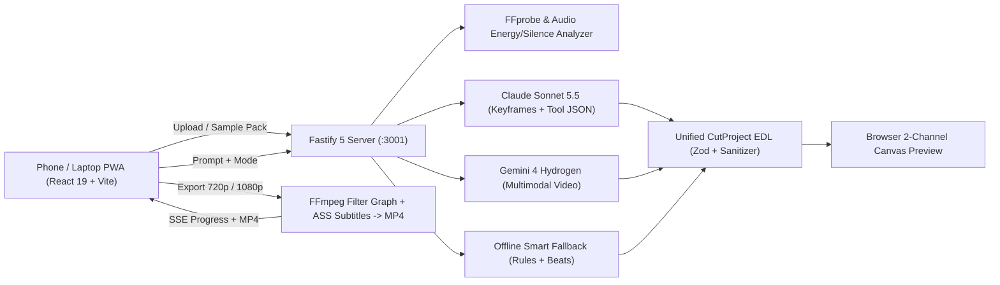

<div align="center">
  
  <h1>CutFlow AI</h1>
  <p>
    <strong>CapCut-Style AI Automated Video Cut-Template Studio for Phone &amp; Laptop</strong>
  </p>
  <p>
    Turn raw clips into beat-synced, stylized reels and videos using natural-language prompts
    (English, Tagalog, or Taglish) — with instant browser Canvas preview and server-side FFmpeg MP4 export.
  </p>

  <p>
    = 22" />
    
    
    
    
    
    
  </p>

  <p>
    <a href="#-quick-start">Quick Start</a> •
    <a href="#-cut-template-presets">Templates</a> •
    <a href="#-architecture">Architecture</a> •
    <a href="#-api-endpoints">API</a> •
    <a href="#-contributors">Contributors</a>
  </p>
</div>

---

## ✨ Features

- **🤖 AI Prompt-to-Edit (English / Tagalog / Taglish)**: Type prompts like *"Gawa ka ng hype 15s TikTok edit with smooth zoom"* or *"Chill aesthetic travel vlog 20s with crossfade"* to generate a complete cut timeline automatically.
- **🧠 Multi-Provider AI + Offline Smart Fallback**:
  - **Claude Sonnet 5.5 (`claude-sonnet-5-5`)**: Inspects video keyframes & audio metadata via forced tool-use JSON output, including automatic `anthropic-workspace-id` discovery for `sk-ant-usr-*` keys.
  - **Gemini Multimodal (`gemini-4-hydrogen`)**: Analyzes uploaded video proxies, images, and beats via `@google/genai` `Interactions API`.
  - **Offline Smart Engine**: Works **with zero API keys** using FFmpeg `silencedetect`, PCM audio energy peak detection, and Taglish/English keyword-to-template rules.
- **📱 Responsive Phone & Laptop PWA**:
  - **Phone**: Thumb-accessible prompt bar, compact preview stage, single-row accessible tabs (`Clips`, `Templates`, `Timeline`, `Inspector`), safe-area insets, and **Add to Home Screen** installability.
  - **Laptop**: 3-pane pro studio layout (`Clips & Templates` · `Live Preview` · `Inspector`) with a full-width multi-track timeline.
- **⚡ Instant Live Preview & Native FFmpeg Export**:
  - Real-time 2-channel `<video>` + Canvas 2D compositor renders motions (`zoom-in`, `zoom-out`, `punch-zoom`, `pan-left`, `pan-right`), transitions (`cut`, `crossfade`, `slide-left`, `flash-white`, `zoom-blur`), color filters, and text overlays before rendering.
  - Server-side FFmpeg compiler exports crisp `1080p` / `720p` H.264/AAC MP4s in `9:16`, `16:9`, or `1:1` with live SSE progress tracking.
- **🎵 Built-in Beat Library & 1-Click Demo Pack**: Includes 3 synthesized royalty-free beat tracks (`128 BPM`, `92 BPM`, `135 BPM`) and a **Try Demo Clips** generator so you can test the full workflow immediately.

---

## 🎨 Cut Template Presets

| Preset ID | Name | Aspect Ratio | Duration | Tempo | Style & Transitions |
|---|---|---:|---:|---:|---|
| `hype-zoom` | **Hype Beat Zoom** | `9:16` | `15s` | `128 BPM` | `punch-zoom`, `zoom-blur`, `flash-white`, `vivid` |
| `chill-vlog` | **Chill Travel Vlog** | `9:16` | `20s` | `92 BPM` | `pan-right`, `crossfade`, `warm-film` |
| `beat-flash` | **Beat Flash Sync** | `9:16` | `12s` | `135 BPM` | `punch-zoom`, `flash-white`, `neon-badge` |
| `cinematic-story` | **Cinematic Story** | `16:9` | `24s` | `80 BPM` | `zoom-out`, `pan-left`, `crossfade`, `cinematic` |
| `product-showcase` | **Smart Product Ad** | `1:1` | `15s` | `118 BPM` | `slide-left`, `zoom-blur`, `capcut-pop` |

---

## 🏗 Architecture



---

## 🚀 Quick Start

### Prerequisites
- **Node.js** `>= 22`
- **pnpm**
- **FFmpeg** & **ffprobe** available in `PATH`

### Installation & Run

```bash
cp .env.example .env
pnpm install
pnpm dev
```

- **Laptop**: Open `http://localhost:5173`
- **Phone (same Wi-Fi)**: Open `http://<your-laptop-lan-ip>:5173` in Chrome/Safari and choose **Add to Home Screen**.
- **First Test Without Clips**: Click **Try Demo Clips** → type a prompt (or tap a vibe chip) → **Auto Edit** → **Export MP4**.

---

## ⚙️ Environment Variables

Copy `.env.example` to `.env` (never commit `.env`). You can also enter optional browser BYOK keys in the **Settings** dialog inside the app.

| Variable | Default | Description |
|---|---|---|
| `ANTHROPIC_API_KEY` | *(empty)* | Optional Anthropic key (`sk-ant-api03-*` or `sk-ant-usr-*`) |
| `ANTHROPIC_MODEL` | `claude-sonnet-5-5` | Anthropic model used for AI Auto-Edit |
| `ANTHROPIC_WORKSPACE_ID` | *(auto)* | Optional workspace ID (auto-discovered for `sk-ant-usr-*` keys) |
| `GEMINI_API_KEY` | *(empty)* | Optional Google Gemini API key |
| `GEMINI_MODEL` | `gemini-4-hydrogen` | Gemini model used for multimodal video analysis |
| `PORT` | `3001` | Fastify API server port |
| `HOST` | `0.0.0.0` | Bind host (`0.0.0.0` enables mobile LAN access) |
| `STORAGE_DIR` | `./data` | Upload, proxy, built-in audio, and render directory |
| `MAX_UPLOAD_MB` | `500` | Maximum upload file size per file |

---

## 🧰 Workspace Scripts

| Command | Description |
|---|---|
| `pnpm dev` | Builds `@cutflow/shared` and starts `shared` watch, `server` (`:3001`), and `web` (`:5173`) |
| `pnpm build` | Builds `@cutflow/shared`, `@cutflow/server`, and `@cutflow/web` (`dist/`) |
| `pnpm test` | Runs Vitest suites across `shared` and `server` (includes real FFmpeg MP4 render & E2E API tests) |
| `pnpm typecheck` | Runs strict TypeScript checks across all workspace packages |

---

<details>
<summary><strong>📁 Project Structure &amp; API Endpoints</strong></summary>

### Monorepo Layout

```text
.
├── shared/    # @cutflow/shared — Zod EDL schemas, timeline layout math, template presets, API DTOs
├── server/    # @cutflow/server — Fastify API, ffprobe/audio analysis, Claude/Gemini/Offline directors, FFmpeg compiler
└── web/       # @cutflow/web    — Responsive React 19 PWA studio, 2-channel Canvas preview, modals & timeline
```

### API Endpoints

- `GET /api/health` — Server FFmpeg & AI provider readiness
- `GET /api/media` — List uploaded & built-in media assets
- `POST /api/media/upload` — Multipart video/image/audio upload + `ffprobe` & beat analysis
- `POST /api/media/sample-pack` — Generate 3 animated demo video clips via FFmpeg
- `GET /api/media/:id/stream` — HTTP `206` byte-range streaming for smooth mobile seeking
- `GET /api/media/:id/thumb` — Cached JPEG thumbnail
- `DELETE /api/media/:id` — Remove user-uploaded asset
- `GET /api/templates` — List built-in Cut Template presets
- `POST /api/projects/auto-edit` — Generate or refine a `CutProject` EDL (`auto`, `claude`, `gemini`, `offline`)
- `POST /api/render` — Enqueue server-side FFmpeg MP4 render (`720p` or `1080p`)
- `GET /api/render/:id` / `GET /api/render/:id/events` — Poll or stream render job progress via SSE
- `GET /api/render/:id/download` — Download rendered MP4

</details>

---

## 👥 Contributors

<table>
  <tr>
    <td align="center">
      <a href="https://github.com/willygailo">
        <br />
        <sub><b>@willygailo</b></sub>
      </a><br />
      <sub>Creator &amp; Maintainer</sub>
    </td>
  </tr>
</table>

See [CONTRIBUTORS.md](./CONTRIBUTORS.md) and the live [GitHub Contributors Graph](https://github.com/willygailo/web-editor/graphs/contributors?from=2026-08-21T16%3A00%3A00.000Z).
