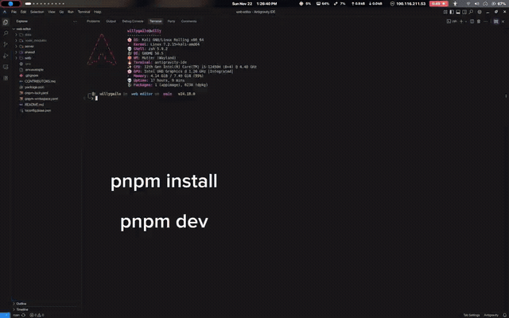
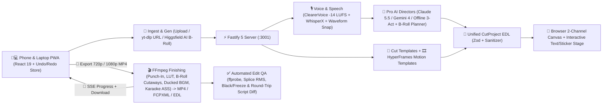

<div align="center">
  
  <h1>🎬 CutFlow AI</h1>
  <p>
    <strong>✨ CapCut-Style AI Automated Video, Talking-Head &amp; Generative B-Roll Studio for 📱 Phone &amp; 💻 Laptop</strong>
  </p>
  <p>
    Turn raw clips or URLs into beat-synced social reels and broadcast-mastered talking-head edits using
    <strong>English, Tagalog, or Taglish</strong> prompts for
    <strong>🎵 TikTok · 📸 IG Reels/Feed (<code>4:5</code>) · ▶️ YouTube Shorts/16:9 · 🛍️ Ads</strong> —
    complete with waveform-snapped jump cuts, studio voice polish, Higgsfield AI B-roll cutaways,
    HyperFrames motion graphics, Karaoke captions, automated Edit QA, and multi-NLE export.
  </p>

  <p>
    = 22" />
    
    
    
    
    
  </p>
  <p>
    
    
    
    
    
    
  </p>

  <p>
    <a href="#-demo">🎬 Demo</a> •
    <a href="#-at-a-glance-studio-capabilities">⚡ Highlights</a> •
    <a href="#-studio-design-layouts">📐 Layouts</a> •
    <a href="#-features">✨ Features</a> •
    <a href="#-how-to-use">🎯 How to Use</a> •
    <a href="#-cut-template-presets">🎨 Templates</a> •
    <a href="#-quick-start">🚀 Quick Start</a> •
    <a href="#-api-key-and-model-setup">🔑 Setup</a> •
    <a href="#-workspace-scripts">🧰 Scripts</a> •
    <a href="#-contributors">👥 Team</a>
  </p>
</div>

---

## 🎬 Demo

<div align="center">
  <a href="./docs/demo.mp4">
    
  </a>
  <p>
    <a href="./docs/demo.mp4"><strong>▶️ Watch / Download Full Demo Video with Audio (MP4 • 2:10)</strong></a>
  </p>
</div>

---

## ⚡ At-a-Glance Studio Capabilities

<table>
  <tr>
    <td width="50%" valign="top">
      <h3>✂️ CapCut-Style Timeline &amp; Multi-Track</h3>
      <p>Scrub beat-marked rulers, <strong>Split (<code>S</code>)</strong>, drag trim edges, swap transitions, layer <strong>BGM / SFX / VO</strong> with SVG waveforms, drag text &amp; stickers with magnetic snap, plus <strong>45-step Undo/Redo</strong> &amp; auto-save.</p>
    </td>
    <td width="50%" valign="top">
      <h3>🎙️ Pro Talking-Head &amp; Voice Polish</h3>
      <p><strong>WhisperX <code>large-v3</code></strong> transcription + <strong>Claude / Gemini / Offline</strong> retake cutting + <strong>PCM waveform valley &amp; zero-crossing snapping</strong> + <strong>ClearerVoice-Studio</strong> &amp; 2-pass <code>-14 LUFS</code> broadcast voice mastering.</p>
    </td>
  </tr>
  <tr>
    <td width="50%" valign="top">
      <h3>🎥 Generative B-Roll &amp; URL Ingest</h3>
      <p>Import clips/audio straight from URLs via <strong><code>yt-dlp</code></strong>, connect <strong>Higgsfield Remote MCP</strong> (<code>https://mcp.higgsfield.ai/mcp</code>) or Cloud API (<em>Kling, Seedance, Veo, DoP, Soul</em>), and composite <strong>full-frame cutaways or PiP</strong> over dialogue.</p>
    </td>
    <td width="50%" valign="top">
      <h3>🎞️ Motion GFX, Captions &amp; Finishing</h3>
      <p>Edited-timeline <strong>Karaoke <code>.ass</code> / <code>.srt</code></strong> captions, <strong>HyperFrames</strong> HTML/CSS/JS intros &amp; CTAs, alternating <strong><code>1.08×</code> punch-in zoom</strong>, color looks &amp; <code>.cube</code> 3D LUTs, sidechain-ducked BGM, and locked platform export specs.</p>
    </td>
  </tr>
  <tr>
    <td width="50%" valign="top">
      <h3>🤖 3-Act Social AI Director (Taglish-Ready)</h3>
      <p>Prompt in <strong>English, Tagalog, or Taglish</strong> for TikTok, IG Reels/Feed (<code>4:5</code>), YT Shorts, or Promo Ads — with <strong>Hook → Body → CTA</strong> pacing, auto-SFX, silent B-roll highlight detection, and copy-ready <code>#hashtags</code>.</p>
    </td>
    <td width="50%" valign="top">
      <h3>✅ Automated Edit QA &amp; Multi-NLE Bridge</h3>
      <p>Proves every cut with <code>ffprobe</code> frame-match, <strong>splice RMS/click audit</strong>, black/freeze checks, and optional round-trip WhisperX playback diff — plus <strong>Premiere MCP, SpliceKit FCP, FCPXML, CMX 3600 EDL, &amp; <code>.cutflow.json</code></strong>.</p>
    </td>
  </tr>
</table>

---

## 📐 Studio Design Layouts

CutFlow AI adapts seamlessly between a **3-pane desktop NLE studio** and a **thumb-friendly mobile PWA** over LAN Wi-Fi:

<table>
  <tr>
    <th width="58%">💻 Laptop / Desktop — 3-Pane Pro Studio</th>
    <th width="42%">📱 Phone PWA — CapCut-Style Mobile</th>
  </tr>
  <tr>
    <td valign="top">

```text
┌──────────────────────────────────────────────────────────┐
│ 🎬 CutFlow AI   [9:16 4:5 16:9 1:1]   ↩️ ↪️  ⚙️  🚀 Export │
├──────────────────┬─────────────────────┬─────────────────┤
│ 🎞️ Clips / 🎵 / 🧩│   🤖 AI Magic Bar   │ 🎛️ Inspector    │
│ ──────────────── │  [Platform Pills]   │ ─────────────── │
│ ⬆️ Upload / ✨Demo│  [Prompt] [✨Edit]  │ ✂️ Trim & Speed │
│ 🔗 Import URL    │  [✂️ Auto Jump-Cut] │ 🎨 Color / LUT  │
│ 🎥 AI Gen B-Roll │ ┌─────────────────┐ │ 📐 Zoom / Flip  │
│ ┌──────┐┌──────┐ │ │                 │ │ 🔤 Text Style   │
│ │Clip 1││Clip 2│ │ │  🎥 Live Canvas │ │ 🏷️ Stickers     │
│ │🎙️ + 🗑││🎙️ + 🗑│ │ │   (Safe Zones   │ │ 🔊 Audio / Duck │
│ └──────┘└──────┘ │ │   + Snap Grid)  │ │                 │
│                  │ └─────────────────┘ │                 │
├──────────────────┴─────────────────────┴─────────────────┤
│ ⏱️ 00:00 ──●────────────── 00:15   [✂️ Split] [🎵 Snap]   │
│ 🎬 Video │ [Take 1][⚡][Take 2 1.08×][✨][Take 3]        │
│ 🔊 Audio │ ▁▃▅▇▅▃▁ BGM (Auto-Ducked)  🔔 SFX   🎙️ VO     │
│ 🔤 Text  │ [🔥 HOOK] [KARAOKE CAPTIONS...] [CTA]          │
│ 🏷️ Stick │ [✨ Badge]  [Logo PNG]                         │
└──────────────────────────────────────────────────────────┘
```

</td>
    <td valign="top">

```text
┌────────────────────────────┐
│ 🎬 CutFlow   ↩️ ↪️ ⚙️ 🚀   │
├────────────────────────────┤
│   ┌────────────────────┐   │
│   │                    │   │
│   │   🎥 9:16 Stage    │   │
│   │  Drag Text/Sticker │   │
│   │   + Safe Zones     │   │
│   │                    │   │
│   └────────────────────┘   │
│    ⏮️   ▶️ 00:04/00:15  ⏭️  │
├────────────────────────────┤
│ 🎬 │[Clip1][⚡][Clip2]     │
│ 🔊 │▁▃▅▇ BGM  🔔 SFX      │
│ 🔤 │[HOOK] [CAPTIONS]      │
├────────────────────────────┤
│ 📋 Active Drawer Sheet     │
│ • AI Magic / Auto Jump-Cut │
│ • Upload / URL / Higgsfield│
├────────────────────────────┤
│ ✨AI 🎞️Clips 🎵Audio 🧩Tpl │
│ ✂️Edit 🎨Adj 🔤Text 🏷️Stk  │
└────────────────────────────┘
```

</td>
  </tr>
</table>

> [!TIP]
> **📱 Install as a Native-Feel Mobile App**: Start `pnpm dev`, open `http://<your-laptop-lan-ip>:5173` on your phone (same Wi-Fi), and tap **Add to Home Screen** — complete with safe-area insets and HTTP `206` byte-range video scrubbing!

---

## ✨ Features

### ✂️ CapCut-Style Multi-Track Timeline & Editor
- 🖱️ **Direct Timeline Manipulation**: Scrub the beat-marked ruler, zoom in/out, **Split at Playhead (`S`)**, drag **clip edge handles** to trim, duplicate or reorder clips, delete selected items (`Delete`/`Backspace`), and click transition badges directly between slots (`cut`, `crossfade`, `flash-white`, `zoom-blur`, `slide-left`).
- 💾 **Auto-Save Drafts & 45-Step Undo / Redo**: Automatically saves active edits to `localStorage` and restores valid timelines across refreshes (with one-click **Reset**), backed by an atomic undo/redo stack (`Ctrl/Cmd+Z`, `Ctrl/Cmd+Shift+Z`).
- 🎚️ **Dedicated Multi-Lanes**: Visual video track, **Audio (`BGM / SFX / VO`)** lane with live offset-synced SVG waveforms and `+ Add Music / SFX` trigger, **Text & Captions** lane, and **Stickers** lane.
- 🥁 **One-Tap Beat Sync & Auto BGM Fit**: Align clip cuts to music beat markers (**Snap Beats**) while automatically syncing BGM length when clips are added, split, or trimmed.

### 🎵 Music, SFX & Voiceover Studio
- 🎛️ **Multi-Track Audio Mixing & Auto-Duck**: Layer background music (`bgm`), sound effects (`sfx`), and voiceovers (`voiceover`) simultaneously with per-track **Timeline Start**, **Song Start**, **Track Length**, **Volume (`0–200%`)**, **Fade In/Out**, and **Duck Music Under Voice / Dialogue** (live gain ducking + FFmpeg `sidechaincompress`).
- 🎧 **Audio Audition & 1-Tap Intro Skip**: Preview any library song or listen right from your current `Song Start` offset (**Listen / Stop**), automatically skip leading dead silence, or hit **Skip Intro →** to jump straight to the song's first beat drop.
- 🔁 **Auto-Attach & Remix Preservation**: Songs uploaded via **Clips** or **Music & SFX** (even before creating a timeline via **Pick Song**) automatically follow into your first clip, **Use Template**, or **Auto Edit**, while AI **Remix** preserves custom BGM offsets, volumes, SFX, and voiceovers.
- 🎼 **Built-in Royalty-Free Audio**:
  - 🎶 **3 Synthesized Music Tracks**: *Neon Drop (128 BPM Hype)*, *Siargao Sunset (92 BPM Chill)*, *Pulse Cut (135 BPM Montage)*.
  - 🔔 **5 Sound Effects (SFX)**: *Transition Whoosh*, *Bass Boom Drop*, *CapCut Text Pop*, *Hype Riser*, *Camera Shutter*.
- 🎙️ **In-Browser Voiceover Recorder & Audio Extractor**: Record straight from phone/laptop mic (`MediaRecorder`) at the playhead, or strip audio from any video clip into a reusable `m4a` track.

### 🧩 Customizable & Reusable Cut Templates
- 🔄 **Use Template Slot Swapper**: Pick any preset or custom template (even before selecting AI clips), swap clips/photos into each labeled slot, customize hook texts and soundtrack, and open straight into the editor.
- 💾 **Save Custom Templates (with Full Styling)**: Turn any edited timeline—including **stickers, reversed clips, color adjustments, and framing transforms**—into a persistent reusable template (`POST /api/templates`) compatible with both **Use Template** and **AI Fill**.
- 📦 **Export / Import `.cutflow.json`**: Share or back up full edits and reusable template blueprints as portable JSON files with schema validation feedback.

### 🎨 Aspect Ratios (`9:16`, `4:5`, `16:9`, `1:1`), Safe Zones & Color Grade
- 📱 **Full Social Format Matrix**: Switch cleanly between **`9:16`** (TikTok / Reels / Shorts), **`4:5`** (Instagram Feed portrait `1080×1350` / `720×900`), **`16:9`** (YouTube Landscape), and **`1:1`** (Square Promo Ads) with live preview & FFmpeg export scaling.
- 🎯 **Direct Canvas Positioning, Snap & Platform Safe Zones**: Drag **Text Overlays** (`bold-hook`, `capcut-pop`, `minimal-caption`, `neon-badge`), built-in **Stickers**, or **Custom Uploaded PNG/JPG Logo Stickers** on the live preview stage with magnetic **center-snap crosshairs** and aspect-aware **Social Safe Zone** guides.
- 🌈 **Color Adjust, Transform & Photo Timing**: Fine-tune brightness, contrast, saturation, warmth, vignette, zoom scale, X/Y offset, rotation, clip speed (`0.5×–2.5×`), **Photo Duration (`0.6s–10s`)**, and **Reverse Clip** across any `0.4s–180s` timeline.
- 💬 **AI Auto-Captions**: Generate timed speech/caption overlays from video or audio tracks using Gemini transcription with automatic offline fallback.

### 🤖 Pro Social AI Director (English / Tagalog / Taglish)
- 🎯 **Platform Target Presets**: Target **`Auto`**, **`TikTok 9:16`**, **`IG Reels`**, **`IG Feed 4:5`**, **`YT Shorts`**, **`YT 16:9`**, or **`Promo 1:1`** directly from the AI bar to adapt pacing, transitions, framing, and caption placement automatically.
- 🎬 **3-Act Storytelling + Timed SFX + Color Polish**: Directs edits with a scroll-stop **Hook (0–2s) → Beat-Synced Body → Climax / CTA**, automatically layering timed built-in SFX (`whoosh`, `pop`, `bass-drop`, `riser`, `shutter`) and cohesive color adjustments.
- 👀 **Silent B-Roll Highlight Detection (`visualHighlightsSec`)**: Runs fast FFmpeg scene-change probing (`gt(scene,0.18)`) on muted/ambient videos so AI directors pick the sharpest visual moments alongside audio energy peaks.
- ✍️ **UI Safe-Zone Clamping & Ready-to-Post Captions**: Keeps AI-generated vertical overlays inside platform safe zones, auto-skips quiet BGM intros, and generates copy-ready **`socialCaption` + `#hashtags`** right inside the Export modal.
- 🧠 **Three Interchangeable Engines**:
  - 🟠 **Claude Sonnet 5.5 (`claude-sonnet-5-5`)**: Forced tool-use EDL JSON with automatic `anthropic-workspace-id` discovery for `sk-ant-usr-*` keys.
  - 🔵 **Gemini Multimodal (`gemini-4-hydrogen`)**: Analyzes uploaded video proxies, images, beats, and speech via `@google/genai` `Interactions API`.
  - 🟡 **Offline Smart Engine**: Works with **zero API keys** using `ffprobe`, scene highlight detection, `silencedetect`, PCM beat/energy peak analysis, auto-SFX, and English/Taglish rules.

### 🎙️ Pro AI Talking-Head, Voice Polish & Generative B-Roll Studio
- ✂️ **1-Click Web Button (`Auto Jump-Cut`)**: Select any talking-head video clip and click **Auto Jump-Cut** (`POST /api/projects/talking-head-cut`) to transcribe once with local **WhisperX `large-v3`**, strip dead air, fillers (`um`, `uh`, isolated Tagalog/Taglish stumbles), false starts, and retakes using **Claude / Gemini / Offline**, snap cut edges onto quiet **PCM waveform RMS valleys & zero-crossings**, and drop **individual trimmable clips** onto the timeline with **auto-generated word-synced captions** and **alternating `1.08×` punch-in zoom**.
- 🔗 **URL Ingest (`yt-dlp`) & 1-Click Voice Polish (`ClearerVoice-Studio`)**: Paste any video/audio URL straight into the Clips bin (**Import URL** → `POST /api/media/import-url` or `pnpm ingest-url`), and click the **🎙️ Polish Voice** action (`POST /api/media/:id/polish-audio`) for broadcast EQ, compression, optional `ClearerVoice-Studio` (`MossFormer2_SE_48K` / `FRCRN_SE_16K`) AI denoising, and **2-pass EBU R128 `-14 LUFS`** loudness mastering.
- 🎥 **Generative AI B-Roll (`Higgsfield MCP` & Cloud API)**: Connect Higgsfield's managed remote MCP (`https://mcp.higgsfield.ai/mcp`) via `pnpm connect-higgsfield` (OAuth login, zero API key needed) or use the **AI Gen B-Roll (Higgsfield)** drawer in the Clips bin (`POST /api/media/generate-higgsfield`) with *Kling, Seedance, Veo, MiniMax, DoP, Soul,* and *Seedream*. Plan timed cutaways with `pnpm plan-broll`, generate with `pnpm gen-broll`, and composite as full-frame **cutaways** or **PiP** cards over continuous dialogue (`--broll-manifest`).
- 🎞️ **Motion Graphics (`HyperFrames`), Karaoke Captions & Automated Edit QA**:
  - 💬 Generate edited-timeline `.srt` & safe-zone word-highlighted Karaoke `.ass` captions (`scripts/generate_captions.py`), plus deterministic HTML/CSS/JS intros, lower-thirds, and CTA outros via `heygen-com/hyperframes` (`scripts/render_motion.py`, with FFmpeg offline fallback).
  - 🤖 Run `pnpm auto-edit` (or continuous `pnpm auto-watch` on `raw/`) with `--polish fast|studio`, `--captions karaoke|minimal`, `--punch-in 1.08`, `--look natural|warm|cinematic|punchy`, `--lut`, `--bgm auto`, `--platform tiktok|reels|shorts|youtube|ig_feed`, `--motion-gfx`, `--broll-plan`, `--export-nle fcpxml,edl,cutflow`, and `--review`.
  - ✅ Every render runs **Automated Edit QA** (`scripts/verify_edit.py` → `transcript/<stem>.qa_report.json`): frame-for-frame `ffprobe` match, loudness `LUFS`/`TP`, splice boundary RMS/click audit, `blackdetect`/`freezedetect`, and optional `--script-check` round-trip WhisperX playback diff.
- 🔌 **Cross-Platform NLE Connectors & Pro Prompt v2**: Bootstrap `Adobe_Premiere_Pro_MCP` (pinned `v1.2.3`), macOS `SpliceKit` (live Final Cut Pro MCP), `Higgsfield MCP`, and `ClearerVoice-Studio` via `scripts/setup_connectors.py`, or grab the copy-pasteable setup prompt in [`docs/PRO_STARTER_PROMPT.md`](./docs/PRO_STARTER_PROMPT.md).

---

## 🎯 How to Use

| Step | Workflow |
|---|---|
| **1️⃣ Launch** | Run `pnpm dev` and open `http://localhost:5173` on laptop (or `http://<your-laptop-lan-ip>:5173` on phone over Wi-Fi). |
| **2️⃣ Add Media** | Drag & drop files into **🎞️ Clips**, paste a link in **🔗 Import URL (`yt-dlp`)**, generate custom visuals in **🎥 AI Gen B-Roll (Higgsfield)**, or tap **✨ Demo Clips**. |
| **3️⃣ Create Edit** | Pick one of 3 paths:<br>• **🧩 Cut Template**: Open **Templates → Use Template**, swap clips into slots, customize hook & song → **Apply**.<br>• **🤖 AI Auto-Edit**: Select clips, choose a **Platform** pill, write a prompt (English/Tagalog/Taglish) → **Auto Edit**.<br>• **✂️ Pro Talking-Head Jump-Cut**: Optionally hit **🎙️ Polish Voice**, then click **Auto Jump-Cut** (or drop clips into `raw/` with `pnpm auto-watch`). |
| **4️⃣ Fine-Tune** | Scrub timeline & press **`S` (Split)**, drag clip edges, tap transition badges, click **🥁 Snap Beats**, layer BGM/SFX/VO with **Auto-Duck**, drag Text/Stickers inside **Safe Zones**, and tweak Color/Reverse/Speed. |
| **5️⃣ Export & Post** | Save custom templates, export `.cutflow.json` / `.fcpxml` / `.edl`, or click **🚀 Export** to copy your **AI Ready-to-Post Caption & `#hashtags`** and render a standard `yuv420p` H.264/AAC MP4 (`720p` / `1080p`). |

<details>
<summary><strong>⌨️ Desktop Keyboard Shortcuts</strong></summary>

| Shortcut | Action |
|---|---|
| `Space` | ▶️ Play / Pause live preview |
| `S` | ✂️ Split clip at current playhead |
| `Ctrl/Cmd + Z` | ↩️ Undo last edit |
| `Ctrl/Cmd + Shift + Z` | ↪️ Redo edit |
| `Delete` / `Backspace` | 🗑️ Delete selected text, sticker, audio track, or clip |

</details>

---

## 🎨 Cut Template Presets

| Preset ID | Name | Aspect | Length | Tempo | Style & Transitions |
|---|---|---:|---:|---:|---|
| `hype-zoom` | 🔥 **Hype Beat Zoom** | `9:16` | `10s` | `128 BPM` | 5 slots · `punch-zoom`, `flash-white`, `zoom-blur`, `vivid` |
| `chill-vlog` | 🌅 **Chill Travel Vlog** | `9:16` | `12s` | `92 BPM` | 4 slots · `pan-left`/`pan-right`, `crossfade`, `warm-film` |
| `beat-flash` | ⚡ **Beat Flash Sync** | `9:16` | `9s` | `135 BPM` | 6 slots · `punch-zoom`, `flash-white`, `neon-badge` |
| `cinematic-story` | 🎬 **Cinematic Story** | `16:9` | `14s` | `80 BPM` | 4 slots · `zoom-out`, `pan-left`, `crossfade`, `cinematic` |
| `product-showcase` | 🛍️ **Smart Product Ad** | `1:1` | `10s` | `118 BPM` | 4 slots · `slide-left`, `zoom-blur`, `capcut-pop` |
| `tiktok-viral-hook` | 🎵 **TikTok Hook & SFX** | `9:16` | `11s` | `128 BPM` | 5 slots · `punch-zoom`, `zoom-blur`, `flash-white`, `bold-hook` |
| `ig-feed-aesthetic` | 📸 **IG Feed 4:5 Portrait** | `4:5` | `12s` | `92 BPM` | 4 slots · `zoom-in`/`pan-right`/`pan-left`, `crossfade`, `warm-film` |
| `yt-shorts-explainer` | ▶️ **Shorts Fast Story** | `9:16` | `13s` | `128 BPM` | 4 slots · `punch-zoom`, `slide-left`, `flash-white`, `neon-badge` |

> [!NOTE]
> Every built-in preset also acts as an editable **slot blueprint** when opened via **🧩 Use Template**, and you can save unlimited custom templates right alongside them.

---

## 🏗 Architecture



---

## 🚀 Quick Start

Runs natively on **🪟 Windows (10/11)**, **🍎 macOS (Apple Silicon & Intel)**, and **🐧 Linux** (plus 🤖 Android / 🍏 iOS mobile browsers over LAN).

### 📋 Prerequisites
- 🟢 **Node.js** `>= 22` & **pnpm** (`corepack enable` or `npm install -g pnpm`)
- 🎞️ **FFmpeg** & **ffprobe** available in `PATH` (or configured via `FFMPEG_PATH` / `FFPROBE_PATH`)
- ⚡ **Optional (for Pro Talking-Head, URL Ingest, Voice Polish & Generative B-Roll)**:
  - 🐍 `uv` + reusable Python 3.11 WhisperX venv:
    ```bash
    uv venv ~/.cache/video-editor/whisperx-venv --python 3.11
    uv pip install --python ~/.cache/video-editor/whisperx-venv/bin/python whisperx
    ```
    *(On Windows Git Bash, use `Scripts/python.exe` instead of `bin/python`.)*
  - 🔗 `yt-dlp` for URL downloads (`pnpm ingest-url` & Web **Import URL**).
  - 🎙️ Optional `ClearerVoice-Studio` isolated venv (`python3 scripts/setup_connectors.py clearvoice`) for `--polish studio` (`MossFormer2_SE_48K`).
  - 🎥 Optional **Higgsfield Remote MCP** (`pnpm connect-higgsfield` → registers `https://mcp.higgsfield.ai/mcp` in `.mcp.json` with OAuth login, zero API key needed).
  - 🩺 Run `pnpm doctor` anytime to verify all local tools, Python venvs, GPU status, and MCP connectors.

<details>
<summary><strong>💻 OS-Specific Install Commands (Windows, macOS &amp; Linux)</strong></summary>

- **🪟 Windows (PowerShell)**:
  ```powershell
  winget install OpenJS.NodeJS.LTS Gyan.FFmpeg astral-sh.uv yt-dlp.yt-dlp
  npm install -g pnpm
  ```
  *(Restart PowerShell afterward so `ffmpeg`, `ffprobe`, and `pnpm` are refreshed in `PATH`. If FFmpeg was unzipped manually, set `FFMPEG_PATH=C:\ffmpeg\bin\ffmpeg.exe` in `.env`.)*
- **🍎 macOS (Homebrew)**:
  ```bash
  brew install node ffmpeg pnpm uv yt-dlp
  ```
- **🐧 Ubuntu / Debian Linux**:
  ```bash
  sudo apt update && sudo apt install -y ffmpeg yt-dlp
  # Install Node.js >= 22 (e.g. via NodeSource or nvm), then:
  npm install -g pnpm
  ```

</details>

### ▶️ Installation & Run

```bash
# macOS / Linux / Windows PowerShell:
cp .env.example .env
# Windows Command Prompt (cmd.exe): copy .env.example .env

pnpm install
pnpm dev
```

- 💻 **Laptop**: Open `http://localhost:5173`
- 📱 **Phone (same Wi-Fi)**: Open `http://<your-laptop-lan-ip>:5173` in Chrome/Safari and choose **Add to Home Screen** *(on Windows, allow Node.js through Windows Defender Firewall when prompted)*.
- ✨ **Try Immediately Without Own Clips**: Tap **Demo Clips** → open **Templates** or **AI Magic** → **Use Template** / **Auto Edit** → edit timeline/audio → **Export**.

---

## 🔑 API Key and Model Setup

CutFlow AI works **even without any API key** using the built-in **Offline Smart Engine** (`ffprobe` + audio beat/silence detection). To unlock multimodal AI editing (**Claude** or **Gemini**), AI **Auto Captions**, or **Higgsfield AI B-Roll**, configure credentials via **Option A** (server `.env`) or **Option B** (browser Settings UI).

### Option A: Using `.env` (Recommended)

1. Copy `.env.example` to `.env` (never commit `.env` to Git):
   ```bash
   cp .env.example .env
   ```
2. Fill in the provider(s) you want to enable:
   ```env
   # --- 🟠 Option 1: Anthropic Claude ---
   ANTHROPIC_API_KEY=sk-ant-api03-your-key-here
   ANTHROPIC_MODEL=claude-sonnet-5-5
   # Only needed if using a user key (sk-ant-usr-*); leave blank for auto-discovery
   ANTHROPIC_WORKSPACE_ID=

   # --- 🔵 Option 2: Google Gemini ---
   GEMINI_API_KEY=AIza-your-gemini-key-here
   GEMINI_MODEL=gemini-4-hydrogen

   # --- 🟣 Option 3: Higgsfield Cloud API (Optional — headless B-roll CLI & Web UI AI Gen) ---
   # Use HF_KEY=key_id:key_secret OR HF_API_KEY_ID + HF_API_KEY_SECRET
   # (Skip if using the OAuth Remote MCP connector via `pnpm connect-higgsfield`)
   HF_KEY=
   HF_DEFAULT_VIDEO_MODEL=kling
   ```
   - 🟠 **Claude (`ANTHROPIC_MODEL`)**: Accepts `sk-ant-api03-*` or `sk-ant-usr-*` (auto-discovers workspace ID if blank).
   - 🔵 **Gemini (`GEMINI_MODEL`)**: Accepts Google AI Studio keys (`AIza...`) for multimodal **Auto Edit**, **Auto Jump-Cut**, **B-Roll Planning**, and **Auto Captions**.
   - 🟣 **Higgsfield (`HF_KEY` or Remote MCP)**: Set `HF_KEY=key_id:key_secret` (from [cloud.higgsfield.ai](https://cloud.higgsfield.ai/api-keys)) for **AI Gen B-Roll (Higgsfield)** in the Web UI and `pnpm gen-broll` CLI — or run `pnpm connect-higgsfield` to use `https://mcp.higgsfield.ai/mcp` via OAuth with your Higgsfield account credits.
3. Restart `pnpm dev` and verify status badges inside **Settings (`⚙️`)**.

### Option B: In-App Browser Settings (No `.env` Restart)

1. Click **Settings (`⚙️`)** in the top-right header to open **AI & Server Settings**.
2. Enter any optional browser-only overrides (**Anthropic Key / Model / Workspace**, **Gemini Key / Model**, **Higgsfield `key_id:key_secret`**) and click **Save**.

> [!NOTE]
> **🔒 Priority & Privacy**: Keys saved in **Settings** remain in your browser's `localStorage` and are sent per request via headers (`x-anthropic-api-key`, `x-anthropic-model`, `x-anthropic-workspace-id`, `x-gemini-api-key`, `x-gemini-model`, `x-higgsfield-key`), cleanly overriding `.env` defaults without writing to disk.

---

## ⚙️ Environment Variables

<details>
<summary><strong>📄 Full <code>.env</code> Reference Table (click to expand)</strong></summary>

| Variable | Default | Description |
|---|---|---|
| `ANTHROPIC_API_KEY` | *(empty)* | 🟠 Optional Anthropic key (`sk-ant-api03-*` or `sk-ant-usr-*`) |
| `ANTHROPIC_MODEL` | `claude-sonnet-5-5` | Anthropic model ID used for AI Auto-Edit & Talking-Head Cuts |
| `ANTHROPIC_WORKSPACE_ID` | *(auto)* | Optional workspace ID (auto-discovered for `sk-ant-usr-*` keys) |
| `GEMINI_API_KEY` | *(empty)* | 🔵 Optional Google Gemini API key |
| `GEMINI_MODEL` | `gemini-4-hydrogen` | Gemini model ID used for AI Auto-Edit, Jump-Cuts & Auto Captions |
| `HF_KEY` | *(empty)* | 🟣 Optional combined Higgsfield Cloud API key (`key_id:key_secret`) |
| `HF_API_KEY_ID` / `HF_API_KEY_SECRET` | *(empty)* | Optional split Higgsfield Cloud API credentials (alternative to `HF_KEY`) |
| `HF_DEFAULT_VIDEO_MODEL` | `kling` | Default Higgsfield video preset (`kling`, `seedance`, `veo`, `minimax`, `dop`) |
| `PORT` | `3001` | Fastify API server port |
| `HOST` | `0.0.0.0` | Bind host (`0.0.0.0` enables mobile LAN access) |
| `STORAGE_DIR` | `./data` | Upload, proxy, built-in audio/SFX, template, and render directory |
| `MAX_UPLOAD_MB` | `500` | Maximum upload file size per file |
| `FFMPEG_PATH` | `ffmpeg` | Optional custom path to `ffmpeg` executable |
| `FFPROBE_PATH` | `ffprobe` | Optional custom path to `ffprobe` executable |

</details>

---

## 🧰 Workspace Scripts

| Command | Purpose |
|---|---|
| `pnpm dev` | 🚀 Builds `@cutflow/shared` and starts `shared` watch, `server` (`:3001`), and `web` (`:5173`) |
| `pnpm build` | 📦 Builds `@cutflow/shared`, `@cutflow/server`, and `@cutflow/web` (`dist/`) |
| `pnpm test` | 🧪 Runs Vitest suites across `shared` and `server` (real FFmpeg MP4 render & E2E API tests) |
| `pnpm typecheck` | 🔍 Runs strict TypeScript checks across all workspace packages |
| `pnpm doctor` | 🩺 Checks `ffmpeg`, `ffprobe`, `uv`, `git`, `node >= 22`, Python 3.11, `yt-dlp`, venvs & MCP connectors |
| `pnpm ingest-url -- <URL>` | 🔗 Downloads video or audio via `yt-dlp` directly into `raw/` |
| `pnpm connect-higgsfield` | 🔌 Registers Higgsfield Remote MCP (`https://mcp.higgsfield.ai/mcp`) in `.mcp.json` |
| `pnpm plan-broll` | 📋 Generates timed Higgsfield AI B-roll cues (`transcript/broll_plan.json`) from `cuts.json` |
| `pnpm gen-broll` | 🎥 Executes single-shot or batch `--plan` Higgsfield Cloud API B-roll generation |
| `pnpm auto-edit` | ✂️ Runs full Pro talking-head pipeline (`--url`, `--polish`, `--captions`, `--punch-in`, `--look`, `--bgm`, `--broll-plan`, `--motion-gfx`, `--export-nle`, `--script-check`, `--review`) |
| `pnpm auto-watch` | 👀 Watches `raw/` continuously and auto-edits newly dropped clips to `output/<name>_cut.mp4` + `./cut.mp4` |
| `python3 -m unittest -v scripts/test_auto_editor.py` | ✅ Runs Python unit & integration tests (waveform snap, `-14 LUFS` polish, B-roll cutaway/PiP, captions, EDL, QA) |

---

<details>
<summary><strong>📁 Project Structure &amp; API Endpoints</strong></summary>

### 🗂️ Monorepo Layout

```text
.
├── shared/    # 🧩 @cutflow/shared — Zod EDL schemas, timeline layout math, template blueprints, sticker catalog, API DTOs
├── server/    # ⚡ @cutflow/server — Fastify API, ffprobe/waveform analysis, URL ingest, voice polish, Higgsfield AI gen, Claude/Gemini/Offline directors, FFmpeg compiler
├── web/       # 💻 @cutflow/web    — Responsive React 19 PWA studio, Undo/Redo store, interactive Canvas preview, multi-track timeline, URL import, Higgsfield B-roll drawer
├── scripts/   # 🐍 Pro Python AI video pipeline — yt-dlp ingest, ClearerVoice -14 LUFS audio polish, WhisperX transcription, waveform boundary snap, karaoke captions, HyperFrames motion templates, Higgsfield B-roll planner/generator, NLE connectors (Premiere MCP, SpliceKit FCP, Higgsfield MCP), & Edit QA
└── docs/      # 📖 Demo preview assets & upgraded v2 Pro AI Video Editor setup prompt (PRO_STARTER_PROMPT.md)
```

### 🔌 API Endpoints

- `GET /api/health` — Server FFmpeg, Claude, Gemini, & Higgsfield (Cloud API / Remote MCP) readiness
- `GET /api/media` — List uploaded & built-in clips, BGM, and SFX assets
- `POST /api/media/upload` — Multipart video/image/audio/voiceover upload + `ffprobe`, beat, & visual scene highlight analysis
- `POST /api/media/import-url` — Download video/audio from URL via `yt-dlp` into the media library
- `POST /api/media/generate-higgsfield` — Generate AI B-roll video or image via Higgsfield Cloud API (`kling`, `seedance`, `veo`, `minimax`, `dop`, `soul`, `seedream`)
- `POST /api/media/:id/polish-audio` — Denoise (`ClearerVoice-Studio` / FFmpeg) + 2-pass EBU R128 `-14 LUFS` voice mastering
- `POST /api/media/sample-pack` — Generate 3 animated demo video clips via FFmpeg
- `GET /api/media/:id/stream` — HTTP `206` byte-range streaming for smooth mobile seeking
- `GET /api/media/:id/thumb` — Cached JPEG thumbnail
- `GET /api/media/:id/waveform` — Cached normalized amplitude peak bins for timeline waveforms
- `POST /api/media/:id/extract-audio` — Extract a video's audio track as a reusable `m4a` asset
- `POST /api/media/:id/transcribe` — Generate timed auto-caption segments (Gemini + offline fallback)
- `DELETE /api/media/:id` — Remove user-uploaded asset
- `GET /api/templates` — List built-in and saved custom Cut Templates
- `POST /api/templates` — Save a custom Cut Template preset
- `DELETE /api/templates/:id` — Delete a saved custom template
- `POST /api/projects/auto-edit` — Generate or refine a platform-targeted `CutProject` EDL with SFX cues & social captions (`auto`, `claude`, `gemini`, `offline`)
- `POST /api/projects/talking-head-cut` — Transcribe via local WhisperX `large-v3` + auto jump-cut (`claude`, `gemini`, `offline`) + waveform boundary snap + edited-timeline captions + alternating `1.08×` punch-in zoom
- `POST /api/render` — Enqueue server-side FFmpeg MP4 render (`720p` or `1080p`)
- `GET /api/render/:id` / `GET /api/render/:id/events` — Poll or stream render job progress via SSE
- `GET /api/render/:id/download` — Download rendered MP4

</details>

---

## 👥 Contributors

<div align="center">
  <table>
    <tr>
      <td align="center">
        <a href="https://github.com/willygailo">
          <br />
          <sub><b>@willygailo</b></sub>
        </a><br />
        <sub>Creator &amp; Maintainer</sub>
      </td>
    </tr>
  </table>
  <p>
    See <a href="./CONTRIBUTORS.md">CONTRIBUTORS.md</a> and the live <a href="https://github.com/willygailo/web-editor/graphs/contributors?from=2026-08-21T16%3A00%3A00.000Z">GitHub Contributors Graph</a>.
  </p>
</div>
