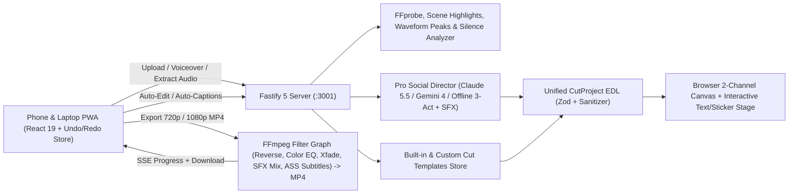

<div align="center">
  
  <h1>CutFlow AI</h1>
  <p>
    <strong>CapCut-Style AI Automated Video &amp; Cut-Template Studio for Phone &amp; Laptop</strong>
  </p>
  <p>
    Turn raw clips into beat-synced social reels using platform-targeted AI prompts (English, Tagalog, or
    Taglish) for <strong>TikTok, Instagram Reels/Feed (<code>4:5</code>), YouTube Shorts, &amp; Ads</strong> —
    complete with 3-act pacing, timed SFX cues, safe-zone captions, ready-to-post hashtags, a multi-track
    timeline, and server-side FFmpeg MP4 export.
  </p>

  <p>
    = 22" />
    
    
    
    
    
    
  </p>

  <p>
    <a href="#-demo">Demo</a> •
    <a href="#-features">Features</a> •
    <a href="#-how-to-use">How to Use</a> •
    <a href="#-cut-template-presets">Templates</a> •
    <a href="#-quick-start">Quick Start</a> •
    <a href="#-api-key-and-model-setup">API Key &amp; Model Setup</a> •
    <a href="#-api-endpoints">API</a> •
    <a href="#-contributors">Contributors</a>
  </p>
</div>

---

## 🎬 Demo

<div align="center">
  <a href="./docs/demo.mp4">
    
  </a>
  <p>
    <a href="./docs/demo.mp4"><strong>Watch / Download Full Demo Video with Audio (MP4 • 2:10)</strong></a>
  </p>
</div>

---

## ✨ Features

### ✂️ CapCut-Style Multi-Track Timeline & Editor
- **Direct Timeline Manipulation**: Scrub the beat-marked ruler, zoom in/out, **Split at Playhead (`S`)**, drag **clip edge handles** to trim, duplicate or reorder clips, delete selected items (`Delete`/`Backspace`), and click transition badges directly between slots (`cut`, `crossfade`, `flash-white`, `zoom-blur`, `slide-left`).
- **Auto-Save Drafts & 45-Step Undo / Redo**: Automatically saves active edits to `localStorage` and restores valid timelines across refreshes (with one-click **Reset**), backed by an atomic undo/redo stack (`Ctrl/Cmd+Z`, `Ctrl/Cmd+Shift+Z`).
- **Dedicated Multi-Lanes**: Visual video track, **Audio (`BGM / SFX / VO`)** lane with live offset-synced SVG waveforms and `+ Add Music / SFX` trigger, **Text & Captions** lane, and **Stickers** lane.
- **One-Tap Beat Sync & Auto BGM Fit**: Align clip cuts to music beat markers (**Snap Beats**) while automatically syncing BGM length when clips are added, split, or trimmed.

### 🎵 Music, SFX & Voiceover Studio
- **Multi-Track Audio Mixing & Auto-Duck**: Layer background music (`bgm`), sound effects (`sfx`), and voiceovers (`voiceover`) simultaneously with per-track **Timeline Start**, **Song Start**, **Track Length**, **Volume (`0–200%`)**, **Fade In/Out**, and **Duck Music Under Voice / Dialogue** (live gain ducking + FFmpeg `sidechaincompress`).
- **Audio Audition & 1-Tap Intro Skip**: Preview any library song or listen right from your current `Song Start` offset (**Listen / Stop**), automatically skip leading dead silence, or hit **Skip Intro →** to jump straight to the song's first beat drop.
- **Auto-Attach & Remix Preservation**: Songs uploaded via **Clips** or **Music & SFX** (even before creating a timeline via **Pick Song**) automatically follow into your first clip, **Use Template**, or **Auto Edit**, while AI **Remix** preserves custom BGM offsets, volumes, SFX, and voiceovers.
- **Built-in Royalty-Free Audio**:
  - **3 Synthesized Music Tracks**: *Neon Drop (128 BPM Hype)*, *Siargao Sunset (92 BPM Chill)*, *Pulse Cut (135 BPM Montage)*.
  - **5 Sound Effects (SFX)**: *Transition Whoosh*, *Bass Boom Drop*, *CapCut Text Pop*, *Hype Riser*, *Camera Shutter*.
- **In-Browser Voiceover Recorder**: Record directly from your phone or laptop mic via `MediaRecorder` (`webm` / `m4a` / `ogg` auto-detected per browser) and drop straight onto the timeline at the playhead.
- **Extract Audio from Video**: Strip audio from any uploaded video clip into a reusable music track (`FFmpeg` AAC extract).

### 🧩 Customizable & Reusable Cut Templates
- **Use Template Slot Swapper**: Pick any preset or custom template (even before selecting AI clips), swap clips/photos into each labeled slot, customize hook texts and soundtrack (preserving any music you already picked), and open straight into the editor.
- **Save Custom Templates (with Full Styling)**: Turn any edited timeline—including **stickers, reversed clips, color adjustments, and framing transforms**—into a persistent reusable template (`POST /api/templates`) compatible with both **Use Template** and **AI Fill**.
- **Export / Import `.cutflow.json`**: Share or back up full edits and reusable template blueprints as portable JSON files with schema validation feedback.

### 🎨 Aspect Ratios (`9:16`, `4:5`, `16:9`, `1:1`), Safe Zones & Color Grade
- **Full Social Format Matrix**: Switch cleanly between **`9:16`** (TikTok / Reels / Shorts), **`4:5`** (Instagram Feed portrait `1080×1350` / `720×900`), **`16:9`** (YouTube Landscape), and **`1:1`** (Square Promo Ads) with live preview & FFmpeg export scaling.
- **Direct Canvas Positioning, Snap & Platform Safe Zones**: Drag **Text Overlays** (`bold-hook`, `capcut-pop`, `minimal-caption`, `neon-badge`), built-in **Stickers**, or **Custom Uploaded PNG/JPG Logo Stickers** on the live preview stage with magnetic **center-snap crosshairs** and aspect-aware **Social Safe Zone** guides.
- **Color Adjust, Transform & Photo Timing**: Fine-tune brightness, contrast, saturation, warmth, vignette, zoom scale, X/Y offset, rotation, clip speed (`0.5x–2.5x`), **Photo Duration (`0.6s–10s`)**, and **Reverse Clip** across any `0.4s–180s` timeline.
- **AI Auto-Captions**: Generate timed speech/caption overlays from video or audio tracks using Gemini transcription with automatic offline fallback.

### 🤖 Pro Social AI Director (English / Tagalog / Taglish)
- **Platform Target Presets**: Target **`Auto`**, **`TikTok 9:16`**, **`IG Reels`**, **`IG Feed 4:5`**, **`YT Shorts`**, **`YT 16:9`**, or **`Promo 1:1`** directly from the AI bar to adapt pacing, transitions, framing, and caption placement automatically.
- **3-Act Storytelling + Timed SFX + Color Polish**: Directs edits with a scroll-stop **Hook (0–2s) → Beat-Synced Body → Climax / CTA**, automatically layering timed built-in SFX (`whoosh`, `pop`, `bass-drop`, `riser`, `shutter`) and cohesive color adjustments.
- **Silent B-Roll Highlight Detection (`visualHighlightsSec`)**: Runs fast FFmpeg scene-change probing (`gt(scene,0.18)`) on muted/ambient videos so AI directors pick the sharpest visual moments alongside audio energy peaks.
- **UI Safe-Zone Clamping & Ready-to-Post Captions**: Keeps AI-generated vertical overlays inside platform safe zones (clearing TikTok/Reels bottom captions and action buttons), auto-skips quiet BGM intros, and generates copy-ready **`socialCaption` + `#hashtags`** right inside the Export modal.
- **Three Interchangeable Engines**:
  - **Claude Sonnet 5.5 (`claude-sonnet-5-5`)**: Forced tool-use EDL JSON with automatic `anthropic-workspace-id` discovery for `sk-ant-usr-*` keys.
  - **Gemini Multimodal (`gemini-4-hydrogen`)**: Analyzes uploaded video proxies, images, beats, and speech via `@google/genai` `Interactions API`.
  - **Offline Smart Engine**: Works with **zero API keys** using `ffprobe`, scene highlight detection, `silencedetect`, PCM beat/energy peak analysis, auto-SFX, and English/Taglish rules.

### 📱 Phone & Laptop PWA
- **Phone**: CapCut-style single-row scrollable bottom tool bar (`AI Magic`, `Clips`, `Audio`, `Templates`, `Edit Clip`, `Adjust`, `Text`, `Stickers`), compact preview stage, safe-area insets, and **Add to Home Screen**.
- **Laptop**: 3-pane pro layout (`Clips / Music & SFX / Templates` · `Live Preview` · `Inspector`) + full multi-track timeline.

---

## 🎯 How to Use

1. **Start the Studio**: Run `pnpm dev` and open `http://localhost:5173` on laptop (or `http://<your-laptop-lan-ip>:5173` on phone over the same Wi-Fi).
2. **Add Media**: Drag & drop videos/photos/audio into **Clips**, or tap **Demo Clips** to generate 3 animated sample videos immediately.
3. **Create an Edit (2 Ways)**:
   - **Use a Cut Template**: Open **Templates → Use Template**, assign your clips to each blueprint slot, edit the hook caption & beat track, and click **Apply**.
   - **AI Auto-Edit**: Select clips in the bin, pick a **Platform** target pill (`Auto`, `TikTok 9:16`, `IG Reels`, `IG Feed 4:5`, `YT Shorts`, `YT 16:9`, `Promo 1:1`), write a prompt (e.g. *"Gawa ka ng hype 15s TikTok viral hook edit with pop captions"*), choose `Auto` / `Claude 5.5` / `Gemini` / `Offline`, and click **Auto Edit**.
4. **Fine-Tune Like CapCut**:
   - **Timeline**: Scrub to any timestamp and press **Split** (`S`), drag clip edges to trim duration, tap transition badges between clips, or click **Snap Beats**.
   - **Music & SFX**: Layer BGM, click **Listen** to check **Song Start** or tap **Skip Intro →** to jump past quiet intros, insert SFX hits at the playhead, record a **Voiceover**, or extract audio from a video clip.
   - **Adjust, Text & Stickers**: Drag text or stickers right on the preview canvas, toggle **Safe Zones** (`9:16`, `4:5`, `16:9`, `1:1`), adjust color/transform/reverse, or run **Auto Captions**.
5. **Save or Export**: Save your timeline under **Templates → Save**, export `.cutflow.json`, or click **Export** to verify attached audio tracks, **copy your AI-generated Ready-to-Post Caption & Hashtags**, render a standard `yuv420p` H.264/AAC MP4 (`720p` / `1080p`), and preview it right inside the Export modal before downloading.

<details>
<summary><strong>⌨️ Desktop Keyboard Shortcuts</strong></summary>

| Shortcut | Action |
|---|---|
| `Space` | Play / Pause live preview |
| `S` | Split clip at current playhead |
| `Ctrl/Cmd + Z` | Undo last edit |
| `Ctrl/Cmd + Shift + Z` | Redo edit |
| `Delete` / `Backspace` | Delete selected text, sticker, audio track, or clip |

</details>

---

## 🎨 Cut Template Presets

| Preset ID | Name | Aspect Ratio | Duration | Tempo | Style & Transitions |
|---|---|---:|---:|---:|---|
| `hype-zoom` | **Hype Beat Zoom** | `9:16` | `10s` | `128 BPM` | 5 slots · `punch-zoom`, `flash-white`, `zoom-blur`, `vivid` |
| `chill-vlog` | **Chill Travel Vlog** | `9:16` | `12s` | `92 BPM` | 4 slots · `pan-left`/`pan-right`, `crossfade`, `warm-film` |
| `beat-flash` | **Beat Flash Sync** | `9:16` | `9s` | `135 BPM` | 6 slots · `punch-zoom`, `flash-white`, `neon-badge` |
| `cinematic-story` | **Cinematic Story** | `16:9` | `14s` | `80 BPM` | 4 slots · `zoom-out`, `pan-left`, `crossfade`, `cinematic` |
| `product-showcase` | **Smart Product Ad** | `1:1` | `10s` | `118 BPM` | 4 slots · `slide-left`, `zoom-blur`, `capcut-pop` |
| `tiktok-viral-hook` | **TikTok Hook & SFX** | `9:16` | `11s` | `128 BPM` | 5 slots · `punch-zoom`, `zoom-blur`, `flash-white`, `bold-hook` |
| `ig-feed-aesthetic` | **IG Feed 4:5 Portrait** | `4:5` | `12s` | `92 BPM` | 4 slots · `zoom-in`/`pan-right`/`pan-left`, `crossfade`, `warm-film` |
| `yt-shorts-explainer` | **Shorts Fast Story** | `9:16` | `13s` | `128 BPM` | 4 slots · `punch-zoom`, `slide-left`, `flash-white`, `neon-badge` |

> Every built-in preset also serves as a **slot blueprint** when opened via **Use Template**, and you can save your own custom templates alongside them.

---

## 🏗 Architecture



---

## 🚀 Quick Start

Runs natively on **Windows (10/11)**, **macOS (Apple Silicon & Intel)**, and **Linux** (plus Android/iOS mobile browsers over LAN).

### Prerequisites
- **Node.js** `>= 22`
- **pnpm** (`corepack enable` or `npm install -g pnpm`)
- **FFmpeg** & **ffprobe** available in `PATH` (or configured via `FFMPEG_PATH` / `FFPROBE_PATH`)

<details>
<summary><strong>💻 OS-Specific Install Commands (Windows, macOS &amp; Linux)</strong></summary>

- **Windows (PowerShell)**:
  ```powershell
  winget install OpenJS.NodeJS.LTS Gyan.FFmpeg
  npm install -g pnpm
  ```
  *(Restart PowerShell afterward so `ffmpeg`, `ffprobe`, and `pnpm` are refreshed in `PATH`. If FFmpeg was unzipped manually, set `FFMPEG_PATH=C:\ffmpeg\bin\ffmpeg.exe` in `.env`.)*
- **macOS (Homebrew)**:
  ```bash
  brew install node ffmpeg pnpm
  ```
- **Ubuntu / Debian Linux**:
  ```bash
  sudo apt update && sudo apt install -y ffmpeg
  # Install Node.js >= 22 (e.g. via NodeSource or nvm), then:
  npm install -g pnpm
  ```

</details>

### Installation & Run

```bash
# macOS / Linux / Windows PowerShell:
cp .env.example .env
# Windows Command Prompt (cmd.exe): copy .env.example .env

pnpm install
pnpm dev
```

- **Laptop**: Open `http://localhost:5173`
- **Phone (same Wi-Fi)**: Open `http://<your-laptop-lan-ip>:5173` in Chrome/Safari and choose **Add to Home Screen** *(on Windows, allow Node.js through Windows Defender Firewall when prompted)*.
- **Try Immediately Without Own Clips**: Tap **Demo Clips** → open **Templates** or **AI Magic** → **Use Template** / **Auto Edit** → edit timeline/audio → **Export**.

---

## 🔑 API Key and Model Setup

CutFlow AI works **even without any API key** using the built-in **Offline Smart Engine** (`ffprobe` + audio beat/silence detection). To unlock AI multimodal editing (**Claude** or **Gemini**) and AI **Auto Captions**, configure at least one provider using **Option A** (server `.env`) or **Option B** (browser Settings UI).

### Option A: Using `.env` (Sets Both API Key & Model ID — Recommended)

1. **Create your `.env` file** in the project root folder (never commit `.env` to Git):
   ```bash
   cp .env.example .env
   ```
2. **Open `.env`** and fill in the **API key** and **Model ID** for the provider(s) you want to use:
   ```env
   # --- Option 1: Anthropic Claude ---
   ANTHROPIC_API_KEY=sk-ant-api03-your-key-here
   ANTHROPIC_MODEL=claude-sonnet-5-5
   # Only needed if using a user key (sk-ant-usr-*); leave blank for auto-discovery
   ANTHROPIC_WORKSPACE_ID=

   # --- Option 2: Google Gemini ---
   GEMINI_API_KEY=AIza-your-gemini-key-here
   GEMINI_MODEL=gemini-4-hydrogen
   ```
   - **Claude (`ANTHROPIC_MODEL`)**: Accepts `sk-ant-api03-*` (standard API keys) or `sk-ant-usr-*` (workspace is auto-discovered if `ANTHROPIC_WORKSPACE_ID` is blank). Set `ANTHROPIC_MODEL` to any valid Anthropic Messages model ID supported by your key (default: `claude-sonnet-5-5`).
   - **Gemini (`GEMINI_MODEL`)**: Accepts Google AI Studio keys (`AIza...`). Used for multimodal video/image analysis in **Auto Edit** with your configured `GEMINI_MODEL` (default: `gemini-4-hydrogen`), and powers **Auto Captions** (`/api/media/:id/transcribe` using `gemini-4-hydrogen`).
3. **Restart the dev server** so `.env` changes take effect (if `pnpm dev` is already running, press `Ctrl + C` and re-run):
   ```bash
   pnpm dev
   ```
4. **Verify in the studio**:
   - Open `http://localhost:5173` and click the **Settings (`⚙️`)** icon in the top-right header (beside **Export**).
   - Under **AI & Server Settings**, confirm the model ID shown and verify it displays **`Configured in .env`**.
5. **Select the AI mode**:
   - In **AI Auto-Cut Director**, pick **`Auto`** (uses **Claude** first → **Gemini** fallback → **Offline** fallback), or choose **`Claude 5.5`**, **`Gemini`**, or **`Offline`** directly.

### Option B: In-App Browser Settings (Quick Key & Model ID Entry — No `.env` Restart)

Use this if you want to enter or override API keys or Model IDs directly from the browser without restarting the server:

1. Click the **Settings (`⚙️`)** icon in the top-right header of CutFlow AI to open **AI & Server Settings**.
2. Fill in any optional overrides:
   - **Optional Browser Anthropic Key** (`sk-ant-api03-...` or `sk-ant-usr-...`)
   - **Claude Model ID** (optional override for server `ANTHROPIC_MODEL`)
   - **Anthropic Workspace ID** (`wrkspc_...`, leave blank to auto-detect for `sk-ant-usr-*` keys)
   - **Optional Browser Gemini Key** (`AIza...`)
   - **Gemini Model ID** (optional override for server `GEMINI_MODEL`)
3. Click **Save**.

> [!NOTE]
> - **Priority & Privacy**: Keys and Model IDs saved in **Settings** stay only in your browser's `localStorage` and are sent via request headers (`x-anthropic-api-key`, `x-anthropic-model`, `x-anthropic-workspace-id`, `x-gemini-api-key`, `x-gemini-model`), overriding server `.env` defaults per request. Leave any field blank to fall back cleanly to `.env` (or **Offline** mode when no key is set).

---

## ⚙️ Environment Variables

Full reference of variables supported in `.env` (see [`.env.example`](./.env.example)):

| Variable | Default | Description |
|---|---|---|
| `ANTHROPIC_API_KEY` | *(empty)* | Optional Anthropic key (`sk-ant-api03-*` or `sk-ant-usr-*`) |
| `ANTHROPIC_MODEL` | `claude-sonnet-5-5` | Anthropic model ID used for AI Auto-Edit |
| `ANTHROPIC_WORKSPACE_ID` | *(auto)* | Optional workspace ID (auto-discovered for `sk-ant-usr-*` keys) |
| `GEMINI_API_KEY` | *(empty)* | Optional Google Gemini API key |
| `GEMINI_MODEL` | `gemini-4-hydrogen` | Gemini model ID used for AI Auto-Edit and Auto Captions |
| `PORT` | `3001` | Fastify API server port |
| `HOST` | `0.0.0.0` | Bind host (`0.0.0.0` enables mobile LAN access) |
| `STORAGE_DIR` | `./data` | Upload, proxy, built-in audio/SFX, template, and render directory |
| `MAX_UPLOAD_MB` | `500` | Maximum upload file size per file |
| `FFMPEG_PATH` | `ffmpeg` | Optional custom path to `ffmpeg` executable (e.g. `C:\ffmpeg\bin\ffmpeg.exe`) |
| `FFPROBE_PATH` | `ffprobe` | Optional custom path to `ffprobe` executable (defaults cleanly next to `FFMPEG_PATH`) |

---

## 🧰 Workspace Scripts

| Command | Description |
|---|---|
| `pnpm dev` | Builds `@cutflow/shared` and starts `shared` watch, `server` (`:3001`), and `web` (`:5173`) |
| `pnpm build` | Builds `@cutflow/shared`, `@cutflow/server`, and `@cutflow/web` (`dist/`) |
| `pnpm test` | Runs Vitest suites across `shared` and `server` (includes real FFmpeg MP4 render & E2E API tests) |
| `pnpm typecheck` | Runs strict TypeScript checks across all workspace packages |

---

<details>
<summary><strong>📁 Project Structure &amp; API Endpoints</strong></summary>

### Monorepo Layout

```text
.
├── shared/    # @cutflow/shared — Zod EDL schemas, timeline layout math, template blueprints, sticker catalog, API DTOs
├── server/    # @cutflow/server — Fastify API, ffprobe/waveform analysis, custom templates store, Claude/Gemini/Offline directors, FFmpeg compiler
└── web/       # @cutflow/web    — Responsive React 19 PWA studio, Undo/Redo store, interactive Canvas preview, multi-track timeline, drawers & modals
```

### API Endpoints

- `GET /api/health` — Server FFmpeg & AI provider readiness
- `GET /api/media` — List uploaded & built-in clips, BGM, and SFX assets
- `POST /api/media/upload` — Multipart video/image/audio/voiceover upload + `ffprobe`, beat, & visual scene highlight analysis
- `POST /api/media/sample-pack` — Generate 3 animated demo video clips via FFmpeg
- `GET /api/media/:id/stream` — HTTP `206` byte-range streaming for smooth mobile seeking
- `GET /api/media/:id/thumb` — Cached JPEG thumbnail
- `GET /api/media/:id/waveform` — Cached normalized amplitude peak bins for timeline waveforms
- `POST /api/media/:id/extract-audio` — Extract a video's audio track as a reusable `m4a` asset
- `POST /api/media/:id/transcribe` — Generate timed auto-caption segments (Gemini + offline fallback)
- `DELETE /api/media/:id` — Remove user-uploaded asset
- `GET /api/templates` — List built-in and saved custom Cut Templates
- `POST /api/templates` — Save a custom Cut Template preset
- `DELETE /api/templates/:id` — Delete a saved custom template
- `POST /api/projects/auto-edit` — Generate or refine a platform-targeted `CutProject` EDL with SFX cues & social captions (`auto`, `claude`, `gemini`, `offline`)
- `POST /api/render` — Enqueue server-side FFmpeg MP4 render (`720p` or `1080p`)
- `GET /api/render/:id` / `GET /api/render/:id/events` — Poll or stream render job progress via SSE
- `GET /api/render/:id/download` — Download rendered MP4

</details>

---

## 👥 Contributors

<table>
  <tr>
    <td align="center">
      <a href="https://github.com/willygailo">
        <br />
        <sub><b>@willygailo</b></sub>
      </a><br />
      <sub>Creator &amp; Maintainer</sub>
    </td>
  </tr>
</table>

See [CONTRIBUTORS.md](./CONTRIBUTORS.md) and the live [GitHub Contributors Graph](https://github.com/willygailo/web-editor/graphs/contributors?from=2026-08-21T16%3A00%3A00.000Z).
