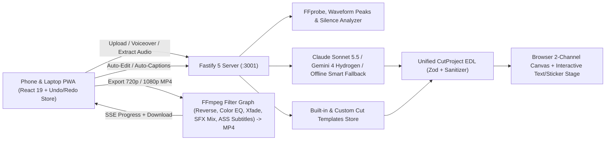

<div align="center">
  
  <h1>CutFlow AI</h1>
  <p>
    <strong>CapCut-Style AI Automated Video &amp; Cut-Template Studio for Phone &amp; Laptop</strong>
  </p>
  <p>
    Turn raw clips into beat-synced reels using AI prompts (English, Tagalog, or Taglish) or customizable
    CapCut-style Cut Templates — with a multi-track timeline, Music/SFX/Voiceover mixer, canvas text &amp;
    sticker dragging, instant Canvas preview, and server-side FFmpeg MP4 export.
  </p>

  <p>
    = 22" />
    
    
    
    
    
    
  </p>

  <p>
    <a href="#-features">Features</a> •
    <a href="#-how-to-use">How to Use</a> •
    <a href="#-cut-template-presets">Templates</a> •
    <a href="#-quick-start">Quick Start</a> •
    <a href="#-api-endpoints">API</a> •
    <a href="#-contributors">Contributors</a>
  </p>
</div>

---

## ✨ Features

### ✂️ CapCut-Style Multi-Track Timeline & Editor
- **Direct Timeline Manipulation**: Scrub the beat-marked ruler, zoom in/out, **Split at Playhead (`S`)**, drag **clip edge handles** to trim, duplicate or reorder clips, and click transition badges directly between slots (`cut`, `crossfade`, `flash-white`, `zoom-blur`, `slide-left`).
- **Undo / Redo History**: Up to 40-step undo/redo stack (`Ctrl/Cmd+Z`, `Ctrl/Cmd+Shift+Z`) across splits, trims, overlays, stickers, and audio edits.
- **Dedicated Multi-Lanes**: Visual video track, **Audio (`BGM / SFX / VO`)** lane with live SVG waveforms, **Text & Captions** lane, and **Stickers** lane.
- **One-Tap Beat Sync**: Automatically align clip cuts to detected music beat markers (**Snap Beats**).

### 🎵 Music, SFX & Voiceover Studio
- **Multi-Track Audio Mixing**: Layer background music (`bgm`), sound effects (`sfx`), and voiceovers (`voiceover`) simultaneously with per-track timeline placement, source trim offset, volume (`0–200%`), fade-in, and fade-out.
- **Built-in Royalty-Free Audio**:
  - **3 Synthesized Music Tracks**: *Neon Drop (128 BPM Hype)*, *Siargao Sunset (92 BPM Chill)*, *Pulse Cut (135 BPM Montage)*.
  - **5 Sound Effects (SFX)**: *Transition Whoosh*, *Bass Boom Drop*, *CapCut Text Pop*, *Hype Riser*, *Camera Shutter*.
- **In-Browser Voiceover Recorder**: Record directly from your phone or laptop mic via `MediaRecorder` and drop straight onto the timeline at the playhead.
- **Extract Audio from Video**: Strip audio from any uploaded video clip into a reusable music track (`FFmpeg` AAC extract).

### 🧩 Customizable & Reusable Cut Templates
- **Use Template Slot Swapper**: Pick any preset or saved template, swap clips/photos into each labeled slot, customize hook texts and soundtrack, and open straight into the editor.
- **Save Custom Templates**: Turn any edited timeline into a persistent reusable template saved on the server (`POST /api/templates`).
- **Export / Import `.cutflow.json`**: Share or back up full edits and reusable template blueprints as portable JSON files.

### 🎨 Canvas Dragging, Color Grade, Speed/Reverse & Auto-Captions
- **Direct Canvas Positioning**: Drag and select **Text Overlays** (`bold-hook`, `capcut-pop`, `minimal-caption`, `neon-badge`, custom colors & animations) and **Stickers** (*Hot / Fire*, *Sparkles*, *Heart*, *Look Here*, *REC Cam*, *VIP Star*) directly on the live preview stage.
- **Color Adjust & Transform**: Fine-tune brightness, contrast, saturation, warmth, vignette, scale, X/Y offset, rotation, speed (`0.5x–2.5x`), and **Reverse Clip**.
- **AI Auto-Captions**: Generate timed speech/caption overlays from video or audio tracks using Gemini transcription with automatic offline fallback.

### 🤖 AI Prompt-to-Edit (English / Tagalog / Taglish)
- **Claude Sonnet 5.5 (`claude-sonnet-5-5`)**: Inspects video keyframes and audio beat metadata via forced tool-use JSON, with automatic `anthropic-workspace-id` discovery for `sk-ant-usr-*` keys.
- **Gemini Multimodal (`gemini-4-hydrogen`)**: Analyzes uploaded video proxies, images, beats, and speech via `@google/genai` `Interactions API`.
- **Offline Smart Engine**: Works with **zero API keys** using `ffprobe`, `silencedetect`, PCM beat/energy peak detection, and English/Taglish keyword-to-template rules.

### 📱 Phone & Laptop PWA
- **Phone**: CapCut-style single-row scrollable bottom tool bar (`AI Magic`, `Clips`, `Audio`, `Templates`, `Edit Clip`, `Adjust`, `Text`, `Stickers`), compact preview stage, safe-area insets, and **Add to Home Screen**.
- **Laptop**: 3-pane pro layout (`Clips / Music & SFX / Templates` · `Live Preview` · `Inspector`) + full multi-track timeline.

---

## 🎯 How to Use

1. **Start the Studio**: Run `pnpm dev` and open `http://localhost:5173` on laptop (or `http://<your-laptop-lan-ip>:5173` on phone over the same Wi-Fi).
2. **Add Media**: Drag & drop videos/photos/audio into **Clips**, or tap **Demo Clips** to generate 3 animated sample videos immediately.
3. **Create an Edit (2 Ways)**:
   - **Use a Cut Template**: Open **Templates → Use Template**, assign your clips to each blueprint slot, edit the hook caption & beat track, and click **Apply**.
   - **AI Auto-Edit**: Select clips in the bin, write a prompt (e.g. *"Gawa ka ng hype 15s TikTok edit with smooth zoom"*), choose `Auto` / `Claude 5.5` / `Gemini` / `Offline`, and click **Auto Edit**.
4. **Fine-Tune Like CapCut**:
   - **Timeline**: Scrub to any timestamp and press **Split** (`S`), drag clip edges to trim duration, tap transition badges between clips, or click **Snap Beats**.
   - **Music & SFX**: Layer BGM, insert SFX hits at the playhead, record a **Voiceover**, or extract audio from a video clip.
   - **Adjust, Text & Stickers**: Drag text or stickers right on the preview canvas, adjust color/transform/reverse, or run **Auto Captions**.
5. **Save or Export**: Save your timeline under **Templates → Save**, export `.cutflow.json`, or click **Export** to render a crisp `720p` / `1080p` H.264/AAC MP4 (`9:16`, `16:9`, or `1:1`).

<details>
<summary><strong>⌨️ Desktop Keyboard Shortcuts</strong></summary>

| Shortcut | Action |
|---|---|
| `Space` | Play / Pause live preview |
| `S` | Split clip at current playhead |
| `Ctrl/Cmd + Z` | Undo last edit |
| `Ctrl/Cmd + Shift + Z` | Redo edit |

</details>

---

## 🎨 Cut Template Presets

| Preset ID | Name | Aspect Ratio | Duration | Tempo | Style & Transitions |
|---|---|---:|---:|---:|---|
| `hype-zoom` | **Hype Beat Zoom** | `9:16` | `10s` | `128 BPM` | 5 slots · `punch-zoom`, `flash-white`, `zoom-blur`, `vivid` |
| `chill-vlog` | **Chill Travel Vlog** | `9:16` | `12s` | `92 BPM` | 4 slots · `pan-left`/`pan-right`, `crossfade`, `warm-film` |
| `beat-flash` | **Beat Flash Sync** | `9:16` | `9s` | `135 BPM` | 6 slots · `punch-zoom`, `flash-white`, `neon-badge` |
| `cinematic-story` | **Cinematic Story** | `16:9` | `14s` | `80 BPM` | 4 slots · `zoom-out`, `pan-left`, `crossfade`, `cinematic` |
| `product-showcase` | **Smart Product Ad** | `1:1` | `10s` | `118 BPM` | 4 slots · `slide-left`, `zoom-blur`, `capcut-pop` |

> Every built-in preset also serves as a **slot blueprint** when opened via **Use Template**, and you can save your own custom templates alongside them.

---

## 🏗 Architecture



---

## 🚀 Quick Start

### Prerequisites
- **Node.js** `>= 22`
- **pnpm**
- **FFmpeg** & **ffprobe** available in `PATH`

### Installation & Run

```bash
cp .env.example .env
pnpm install
pnpm dev
```

- **Laptop**: Open `http://localhost:5173`
- **Phone (same Wi-Fi)**: Open `http://<your-laptop-lan-ip>:5173` in Chrome/Safari and choose **Add to Home Screen**.
- **Try Immediately Without Own Clips**: Tap **Demo Clips** → open **Templates** or **AI Magic** → **Use Template** / **Auto Edit** → edit timeline/audio → **Export**.

---

## ⚙️ Environment Variables

Copy `.env.example` to `.env` (never commit `.env`). You can also enter optional browser BYOK keys in the **Settings** dialog inside the app.

| Variable | Default | Description |
|---|---|---|
| `ANTHROPIC_API_KEY` | *(empty)* | Optional Anthropic key (`sk-ant-api03-*` or `sk-ant-usr-*`) |
| `ANTHROPIC_MODEL` | `claude-sonnet-5-5` | Anthropic model used for AI Auto-Edit |
| `ANTHROPIC_WORKSPACE_ID` | *(auto)* | Optional workspace ID (auto-discovered for `sk-ant-usr-*` keys) |
| `GEMINI_API_KEY` | *(empty)* | Optional Google Gemini API key |
| `GEMINI_MODEL` | `gemini-4-hydrogen` | Gemini model used for multimodal video analysis & auto-captions |
| `PORT` | `3001` | Fastify API server port |
| `HOST` | `0.0.0.0` | Bind host (`0.0.0.0` enables mobile LAN access) |
| `STORAGE_DIR` | `./data` | Upload, proxy, built-in audio/SFX, template, and render directory |
| `MAX_UPLOAD_MB` | `500` | Maximum upload file size per file |

---

## 🧰 Workspace Scripts

| Command | Description |
|---|---|
| `pnpm dev` | Builds `@cutflow/shared` and starts `shared` watch, `server` (`:3001`), and `web` (`:5173`) |
| `pnpm build` | Builds `@cutflow/shared`, `@cutflow/server`, and `@cutflow/web` (`dist/`) |
| `pnpm test` | Runs Vitest suites across `shared` and `server` (includes real FFmpeg MP4 render & E2E API tests) |
| `pnpm typecheck` | Runs strict TypeScript checks across all workspace packages |

---

<details>
<summary><strong>📁 Project Structure &amp; API Endpoints</strong></summary>

### Monorepo Layout

```text
.
├── shared/    # @cutflow/shared — Zod EDL schemas, timeline layout math, template blueprints, sticker catalog, API DTOs
├── server/    # @cutflow/server — Fastify API, ffprobe/waveform analysis, custom templates store, Claude/Gemini/Offline directors, FFmpeg compiler
└── web/       # @cutflow/web    — Responsive React 19 PWA studio, Undo/Redo store, interactive Canvas preview, multi-track timeline, drawers & modals
```

### API Endpoints

- `GET /api/health` — Server FFmpeg & AI provider readiness
- `GET /api/media` — List uploaded & built-in clips, BGM, and SFX assets
- `POST /api/media/upload` — Multipart video/image/audio/voiceover upload + `ffprobe` & beat analysis
- `POST /api/media/sample-pack` — Generate 3 animated demo video clips via FFmpeg
- `GET /api/media/:id/stream` — HTTP `206` byte-range streaming for smooth mobile seeking
- `GET /api/media/:id/thumb` — Cached JPEG thumbnail
- `GET /api/media/:id/waveform` — Cached normalized amplitude peak bins for timeline waveforms
- `POST /api/media/:id/extract-audio` — Extract a video's audio track as a reusable `m4a` asset
- `POST /api/media/:id/transcribe` — Generate timed auto-caption segments (Gemini + offline fallback)
- `DELETE /api/media/:id` — Remove user-uploaded asset
- `GET /api/templates` — List built-in and saved custom Cut Templates
- `POST /api/templates` — Save a custom Cut Template preset
- `DELETE /api/templates/:id` — Delete a saved custom template
- `POST /api/projects/auto-edit` — Generate or refine a `CutProject` EDL (`auto`, `claude`, `gemini`, `offline`)
- `POST /api/render` — Enqueue server-side FFmpeg MP4 render (`720p` or `1080p`)
- `GET /api/render/:id` / `GET /api/render/:id/events` — Poll or stream render job progress via SSE
- `GET /api/render/:id/download` — Download rendered MP4

</details>

---

## 👥 Contributors

<table>
  <tr>
    <td align="center">
      <a href="https://github.com/willygailo">
        <br />
        <sub><b>@willygailo</b></sub>
      </a><br />
      <sub>Creator &amp; Maintainer</sub>
    </td>
  </tr>
</table>

See [CONTRIBUTORS.md](./CONTRIBUTORS.md) and the live [GitHub Contributors Graph](https://github.com/willygailo/web-editor/graphs/contributors?from=2026-08-21T16%3A00%3A00.000Z).
